# ASF-PluginConfig

An [ArchiSteamFarm](https://github.com/JustArchiNET/ArchiSteamFarm) (ASF) plugin that gives one page to edit the
configuration of other installed plugins. Each plugin that wants a form embeds a JSON Schema in its DLL; the host
builds the form from it and writes the plugin's own key in `ASF.json` or `config/<bot>.json`, or the plugin's own
settings file in `config/plugins/`.

It edits global and per-bot settings, keeps secrets on the server, edits the key of a plugin that has no schema as raw
JSON, and has a button that asks ASF to update plugins. See the [changelog](CHANGELOG.md) and the
[design](https://github.com/easly1989/ASF-PluginConfig/issues/1).

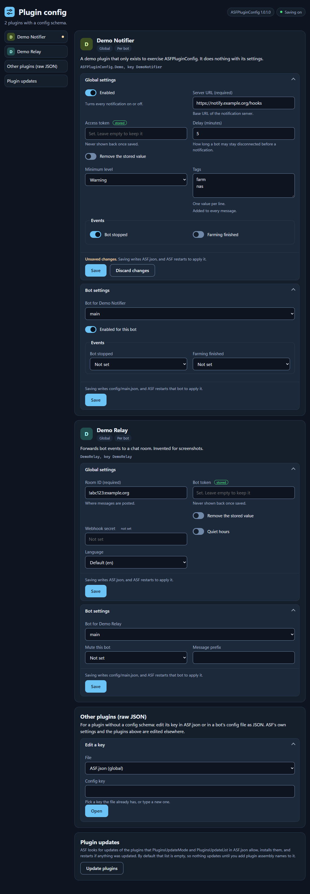

## Install

1. Download `ASFPluginConfig.zip` from the [latest release](https://github.com/easly1989/ASF-PluginConfig/releases/latest).
2. Unzip it into ASF's `plugins/ASFPluginConfig/` folder.
3. Restart ASF.
4. Open `http://<asf-host>:1242/plugin-config/` (with the trailing slash) and enter ASF's IPC password when asked.
   ASF bans an address for an hour after 5 wrong passwords; the page stores the password for the browser tab only
   after ASF accepts it.

Requires ASF 6.3.11.7 or later, with IPC enabled. A plugin references the exact ASF version it was built against and ASF refuses to load it on an older one, so each ASF bump raises this minimum.

Saving needs `IPCPassword` set in `ASF.json`. If ASF's IPC is reachable only from your LAN or a VPN and you prefer not to set one, see [Saving without `IPCPassword`](#saving-without-ipcpassword).

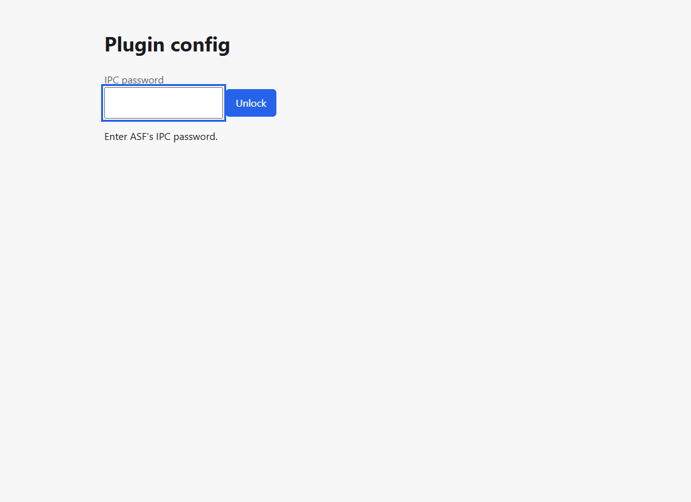
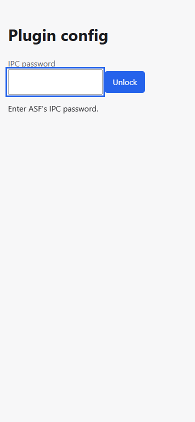

## Use

Each plugin that ships a schema gets a card. Open **Global settings**, or **Bot settings** and pick a bot, then change the form and save:
- **Validation first.** The host checks the value against the plugin's schema. Nothing is written until every field passes; errors appear next to their fields.
- **Only that plugin's key changes.** The host rewrites the plugin's key in `ASF.json` and keeps every other key. Keys inside the plugin's value that the schema does not know are kept too. Comments in `ASF.json` are not kept.
- **Or the plugin's own file.** A plugin that declares [file storage](#for-plugin-authors-a-settings-file-of-your-own) keeps its global and bot settings in `config/plugins/<AssemblyName>.json` instead, and `ASF.json` and the bot files are not touched. The first save creates the file.
- **No silent overwrite.** If the file changed after you opened the form, for example from ASF-ui or an editor, the save is refused. Reopen the form and save again.
- **ASF restarts to apply it.** ASF restarts after any change to `ASF.json`. If `AutoRestart` is off, it stops instead, and the page says so before you save. ASF does not watch plugin files, so for a plugin with file storage the host restarts ASF itself after the save (or stops it, when `AutoRestart` is off), unless the plugin declares that it reloads its file live; then nothing restarts. The save's answer says which happened.
- **A bot save restarts only that bot.** Bot settings go into `config/<bot>.json`, and ASF restarts just that bot. For a plugin with file storage they go into its file, under `bots`, and a save restarts all of ASF (or nothing, for a live plugin). The bot picker lists the bot config files ASF would load.
- **Updating plugins.** **Update plugins** at the bottom asks ASF to update the plugins its `PluginsUpdateMode` and `PluginsUpdateList` settings allow, and shows ASF's answer. ASF downloads and installs them itself, then restarts if anything changed (or stops, when `AutoRestart` is off); this plugin installs nothing. By default `PluginsUpdateList` is empty, so nothing updates until you add the plugins' assembly names to it, for example `ASFPluginConfig`.
- **Secrets stay on the server.** A secret field (`writeOnly` in the schema) is never sent to the page, only whether it is set. Leave it empty to keep the stored value, type a new one to replace it, or tick **Remove the stored value**.
- **Saving needs `IPCPassword`, unless you opt out.** Saving is refused while `IPCPassword` is empty in `ASF.json`. If ASF's IPC is reachable only from your LAN or a VPN, you can allow saving without it (see below).

A plugin's global settings, with a secret that is set (its value is never shown) and, below it, a bot's settings:

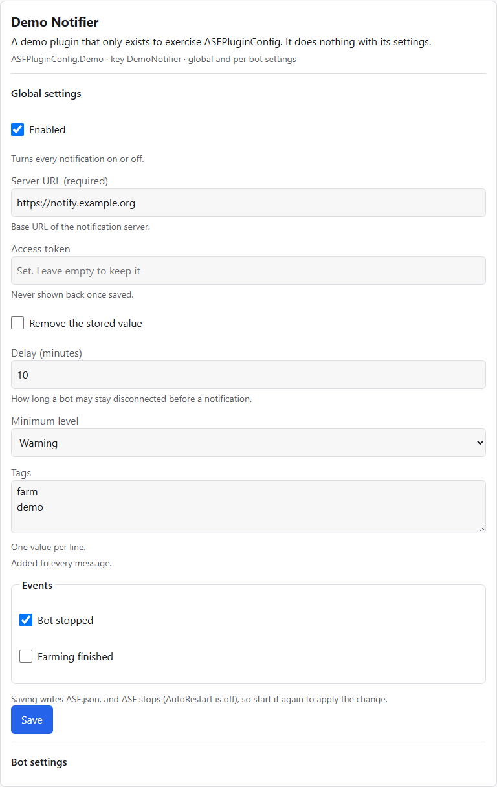
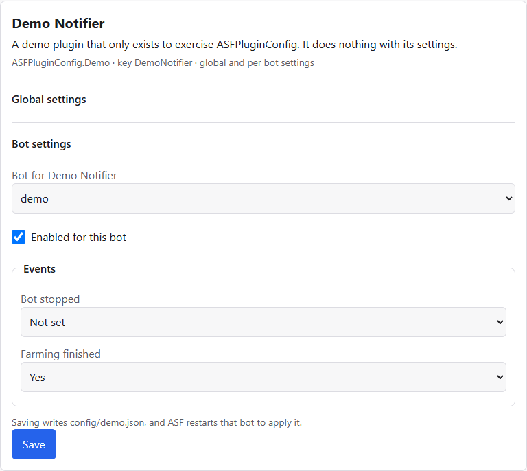

Errors appear next to their fields, and nothing is written until the form is valid (left); the same form on a phone (right):

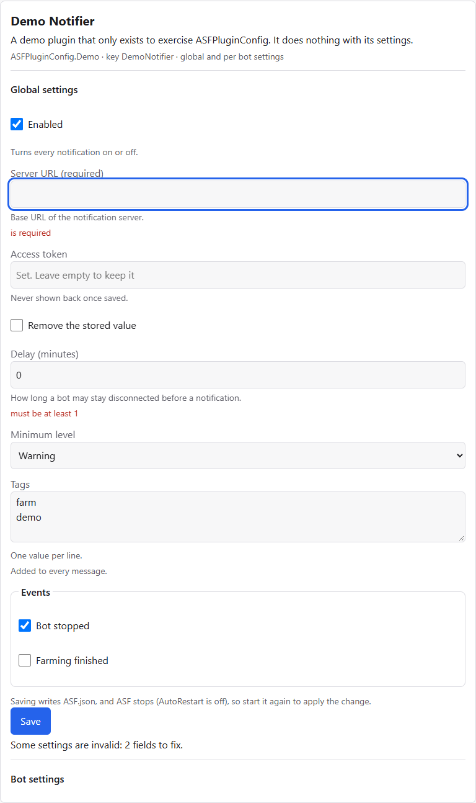
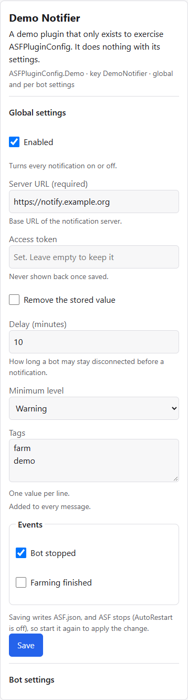

The update button, after ASF answered (nothing was eligible, so ASF says so in the system's language):

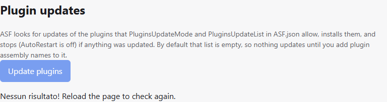

### Plugins without a schema

The **Other plugins (raw JSON)** card edits one top-level key of `ASF.json` or of a bot's config file as JSON. Pick a key the file already has or type a new one, edit the value and save; `null` removes the key. Saves go through the same checks as the forms. ASF's own settings and the keys of plugins that ship a schema are refused there.

Raw values are shown as stored, so a secret in a plugin's key is visible to anyone who can open the page. Reading them therefore needs a real `IPCPassword`: without one the card is hidden and the endpoints answer 403, and the [opt-in below](#saving-without-ipcpassword) does not change that. If a plugin's schema is invalid, or ASF Plugin Config cannot read the schemas at all, the raw editor refuses the affected keys, or every key, since their secrets cannot be told apart; ASF's log says why. A plugin that wants its secrets hidden ships a schema and marks them `writeOnly`.

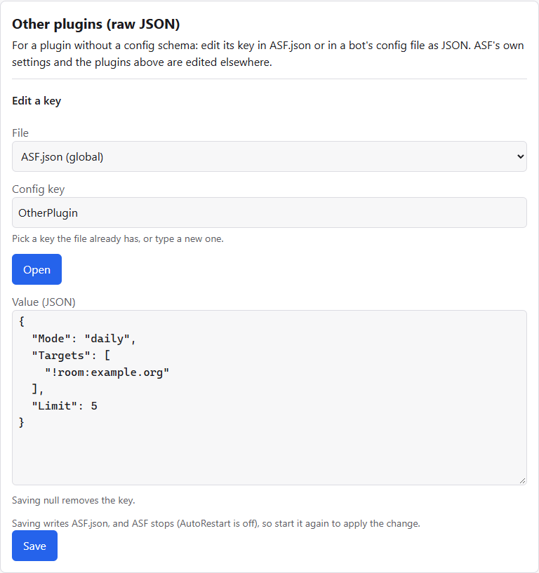
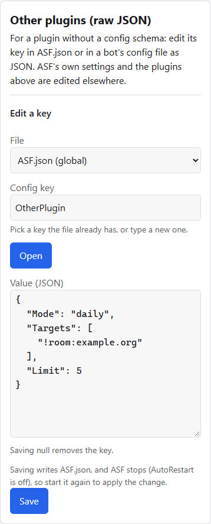

### Saving without `IPCPassword`

Add this to `ASF.json`, or turn on **Allow saving without IPCPassword** in this plugin's own card on the page while `IPCPassword` is still set:

```json
"ASFPluginConfig": { "AllowWritesWithoutIPCPassword": true }
```

With it on and `IPCPassword` empty, anyone who can reach ASF's IPC can change your plugins' settings. ASF logs a warning at start-up and the page shows one at the top. Secrets of plugins with a schema are still never returned. The raw JSON editor shows values as stored, so it stays off, whatever the opt-in says, until `IPCPassword` is set. Keep IPC reachable only from networks you trust.

With the opt-in on, the page shows a banner, and the raw JSON card is hidden (left). With neither `IPCPassword` nor the opt-in, saving is off and the banner says so (right):

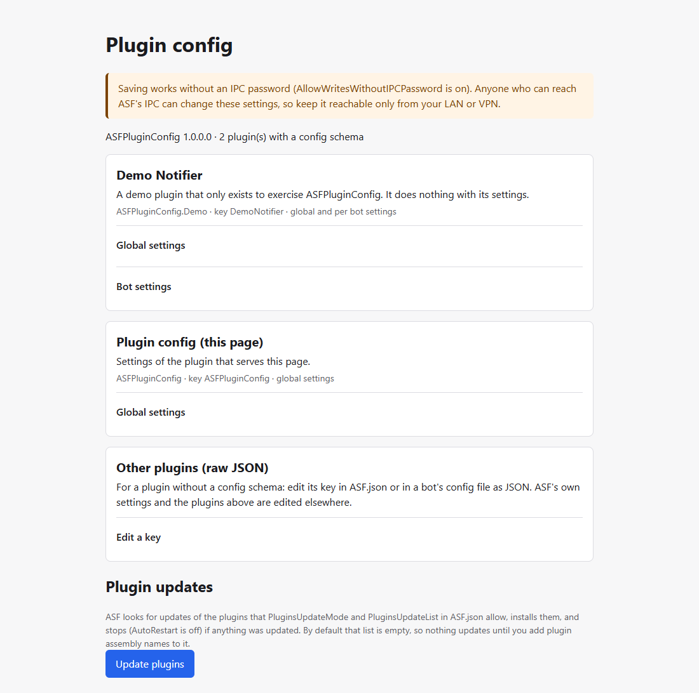
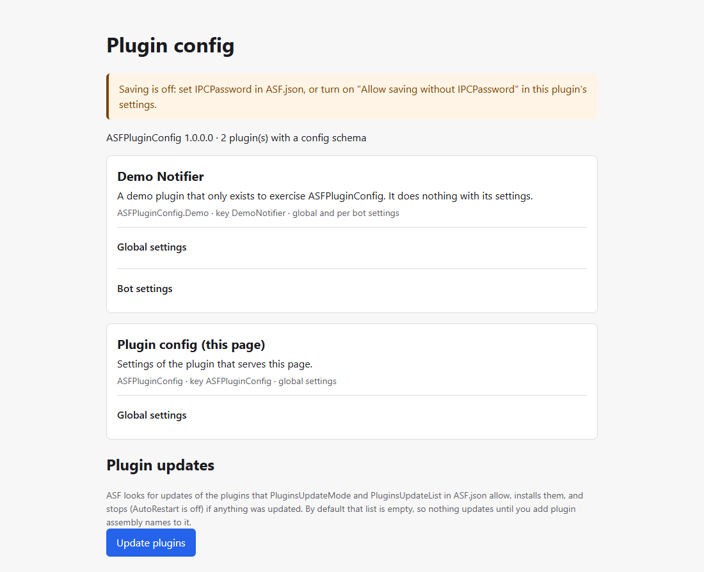
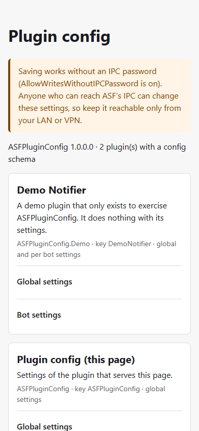
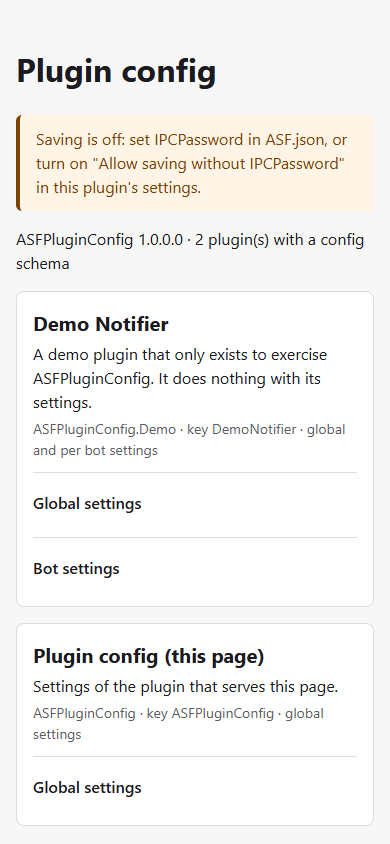

## Security notes

- **The guard is ASF's `IPCPassword`.** Every endpoint of this plugin is under `/Api/PluginConfig/`, which ASF's IPC password check covers. Without a password, ASF itself lets in only loopback and its `KnownNetworks`, and bans an address for an hour after 5 wrong passwords. On top of that, this plugin refuses every save while `IPCPassword` is empty, unless you opted in, and every raw read whatever the opt-in says.
- **Why the opt-in does not open raw reads.** ASF's IPC does not restrict which `Host` names it answers to. So even an IPC that only your LAN can reach can be reached by a web page opened in a browser on that LAN, through that browser (DNS rebinding). An `IPCPassword` stops such a page; the opt-in, which leaves protection to the network, does not. With the opt-in on, such a page could still use the forms and change settings: that is the risk the opt-in accepts. It must not also be able to read values that are not masked.
- **Versions do not leak file content.** The version a save must send back is a keyed hash that only this ASF process can reproduce, so it cannot be used to test guesses for the short secrets in a config file, such as a Steam parental code.
- **The page refuses to run in a frame**, so another site cannot frame it and click through it for a visitor.
- **Secrets never leave the host.** A schema field marked `writeOnly` is dropped from every response and reported only as set or not set. A save that leaves it out keeps the stored value, and only an explicit *Remove the stored value* deletes it. A `writeOnly` field must be a plain string property, not an array item.
- **The raw editor cannot reach those secrets.** It refuses ASF's own settings and every key that has a schema, including one whose schema this plugin rejected as invalid, and the legacy `ASF.json` key of a plugin with file storage. If it cannot tell which keys are safe, because a plugin's schema could not be read, it refuses all of them. For a plugin without a schema, values are shown as stored, which is why raw reads need a real `IPCPassword`. It never reads or writes plugin files.
- **Plugin files are out of ASF's reach.** ASF's own `GET /Api/ASF` returns `ASF.json` as stored, secrets included; a plugin file in `config/plugins/` is served by no endpoint, and this plugin masks its `writeOnly` values as it does everywhere. Its path comes only from the assembly name of a loaded plugin, which must match `^[A-Za-z0-9][A-Za-z0-9._-]{0,99}$` (otherwise the plugin's file storage is refused and ASF's log says why); nothing in a request becomes part of a path. A symbolic link or junction at `config/plugins` or at the file is refused, not followed. No value is ever logged.
- **The page itself holds no data.** `/plugin-config/` is a static page, served without a password. Everything it shows comes from `/Api` after you enter the IPC password, which the page keeps for the browser tab only.
- **What ASF itself still exposes.** Whoever can use ASF's IPC can already run commands, restart or stop ASF, start and stop bots, and change or delete bot configurations through ASF's own endpoints. This plugin neither widens nor narrows that. It only adds editing the settings of plugins. Keep IPC off the internet.
- **Config files stay plain text on disk**, as in ASF itself. Their permissions are yours to set. On Linux and macOS a save keeps the file's mode as it was when the save started, so a file restricted to its owner stays so (a `chmod` made while the save runs is undone). The new file gets the owner and group of the process that runs ASF and the folder's ACL, not the original's; this matters on shares with ACLs, such as a Synology.
- **A new plugin file gets the default mode.** The first save of a plugin with file storage creates `config/plugins/<AssemblyName>.json` with the mode your umask gives (trimmed ASF can neither read nor set one), so it may be readable by others. If the plugin keeps secrets there, create the file empty first with the mode you want, for example `touch config/plugins/MyPlugin.json && chmod 600 config/plugins/MyPlugin.json`; an existing file keeps its mode on every save.
- **Known gap**: a write by ASF in the instant between this plugin's last check of the file and its swap is lost ([#18](https://github.com/easly1989/ASF-PluginConfig/issues/18)). The window is tiny: the plugin compares the file once more right before the swap and refuses the save if it changed.
- **A plugin that loads after start-up** is never scanned for a schema, so the raw editor turns itself off until ASF restarts. ASF loads every plugin before this plugin starts, so this should not happen in a normal setup.

## For plugin authors: the schema contract

Your plugin keeps reading its settings as it does today, from `OnASFInit` and `OnBotInitModules`. To get a form, embed one
JSON file in your DLL. You need no code change and no shared assembly.

1. Add `config.schema.json` to your plugin project and embed it under a fixed name:

   ```xml
   <ItemGroup>
   	<EmbeddedResource Include="config.schema.json" LogicalName="$(AssemblyName).config.schema.json" />
   </ItemGroup>
   ```

2. Describe your config key and its settings:

   ```json
   {
   	"configKey": "MyPlugin",
   	"title": "My plugin",
   	"description": "What the plugin does, shown on the page.",
   	"global": {
   		"type": "object",
   		"required": ["ServerUrl"],
   		"properties": {
   			"Enabled": { "type": "boolean", "default": true },
   			"ServerUrl": { "type": "string", "format": "uri", "title": "Server URL" },
   			"Token": { "type": "string", "writeOnly": true },
   			"DelayMinutes": { "type": "integer", "minimum": 1, "maximum": 1440, "default": 5 },
   			"Level": { "type": "string", "enum": ["Info", "Warning", "Error"] },
   			"Tags": { "type": "array", "items": { "type": "string" } }
   		}
   	},
   	"bot": {
   		"type": "object",
   		"properties": { "Enabled": { "type": "boolean" } }
   	}
   }
   ```

What the document must contain:
- `configKey`: required. Your top-level key in `ASF.json` and in `config/<bot>.json`. It cannot be one of ASF's own settings. When two plugins claim one key, the assembly whose name sorts first keeps it.
- `global` and `bot`: at least one, each with `"type": "object"`. `global` is the key in `ASF.json`; `bot` is the key in each bot's config.
- `title` and `description`: optional. `title` falls back to `configKey`.
- `$schema`: allowed, and ignored.

Keywords inside a schema; anything else makes the host ignore your schema and log why:

| Keyword | Applies to |
|---|---|
| `type` (required): `object`, `string`, `integer`, `number`, `boolean`, `array` | every schema |
| `title`, `description` (strings); `default` and `enum` (non-empty), whose values must match `type`, `minimum` and `maximum` | every schema |
| `properties`, `required` (names among `properties`) | `object` |
| `items` (required: a `string`, `integer`, `number` or `boolean` schema) | `array` |
| `minimum`, `maximum` (`minimum` ≤ `maximum`) | `integer`, `number` |
| `format`: only `uri` | `string` |
| `writeOnly`: a secret, never sent back to the page; not allowed on array items | `string` |

A `boolean` with a `default` shows as a checkbox. Without one, it shows as *Not set / Yes / No*, and *Not set* leaves the key out. Use this for a per-bot value that inherits a global one: a checkbox always writes `true` or `false`.

Browsers lose digits beyond 2^53. Store a larger integer, such as a SteamID, as a `string`; the host refuses to save an `integer` above that.

If your schema is invalid, the host ignores it, logs why, and its raw editor refuses your key until you fix it, so a secret under that key is never shown.

## For plugin authors: a settings file of your own

By default the host writes your `configKey` in `ASF.json` and the bot files, and you need no code change. Instead, your
settings can live in a file of their own, `config/plugins/<AssemblyName>.json`. ASF's IPC never serves that file, while
`GET /Api/ASF` returns `ASF.json` as stored, secrets included. The cost: you read the file yourself, with the few lines
below.

Opt in with three top-level keys of your schema:

```json
{
	"configKey": "MyPlugin",
	"storage": "file",
	"formatVersion": 1,
	"reload": "restart",
	"global": { "type": "object", "properties": { "Token": { "type": "string", "writeOnly": true } } },
	"bot": { "type": "object", "properties": { "Enabled": { "type": "boolean" } } }
}
```

- `storage`: `"asf-json"` (the default: your key in `ASF.json` and the bot files, as above) or `"file"`.
- `formatVersion`: required with `"file"`, and must be `1`. A host that does not know the number ignores your schema and logs why.
- `reload`: only with `"file"`. `"restart"` (the default): after a save the host restarts ASF, or stops it when `AutoRestart` is off, since ASF does not watch this file; a bot save restarts all of ASF, not only that bot. `"live"`: the host restarts nothing, and your plugin watches its file and applies a change itself.
- `configKey` stays required: it is the title's fallback and names your legacy key in `ASF.json`, which the raw editor then refuses so a secret left there is not shown.
- Your assembly name names the file, so it must match `^[A-Za-z0-9][A-Za-z0-9._-]{0,99}$`; otherwise the host refuses your schema and logs why.

The file, which the first save creates, along with `config/plugins/`:

```json
{ "formatVersion": 1, "global": { }, "bots": { "<bot name>": { } } }
```

`global` follows your schema's `global` part and each entry of `bots` its `bot` part; a bot's name is its config file's
name without `.json`. Unknown properties and entries for bots that no longer exist are kept on save; comments and
trailing commas are read but not kept. The host never rewrites a file whose `formatVersion` it does not know, or whose
`bots` is not an object: the form shows an error instead.

A reader to copy. It runs in ASF's trimmed builds, since it uses the same calls as this plugin, which CI checks
against them (`TryGetProperty`, for one, is not available there):

```csharp
using System;
using System.IO;
using System.Text.Json;
using ArchiSteamFarm;

internal static class MyPluginSettings {
	private const string FileName = "MyPlugin.json"; // <AssemblyName>.json

	private static readonly JsonDocumentOptions Options = new() { AllowTrailingCommas = true, CommentHandling = JsonCommentHandling.Skip };

	// The global value (bot null) or that bot's; null when the file or the value is missing.
	// Throws JsonException for a file that is not valid JSON, InvalidDataException for a format it does not know.
	internal static JsonElement? Read(string? bot = null) {
		string path = Path.Combine(SharedInfo.ConfigDirectory, "plugins", FileName);

		if (!File.Exists(path)) {
			return null;
		}

		byte[] bytes = File.ReadAllBytes(path);

		if (bytes.Length == 0) {
			return null;
		}

		// Notepad saves a UTF-8 byte order mark, which JsonDocument refuses
		ReadOnlyMemory<byte> json = bytes.AsSpan().StartsWith((ReadOnlySpan<byte>) [0xEF, 0xBB, 0xBF]) ? bytes.AsMemory(3) : bytes;

		using JsonDocument document = JsonDocument.Parse(json, Options);

		if (Property(document.RootElement, "formatVersion") is not { ValueKind: JsonValueKind.Number } version || (version.GetDouble() != 1)) {
			throw new InvalidDataException($"{FileName} has a format this plugin does not know");
		}

		JsonElement? value = bot == null ? Property(document.RootElement, "global") : Property(document.RootElement, "bots") is { } bots ? Property(bots, bot) : null;

		return value?.Clone();
	}

	private static JsonElement? Property(JsonElement element, string name) {
		if (element.ValueKind != JsonValueKind.Object) {
			return null;
		}

		foreach (JsonProperty property in element.EnumerateObject()) {
			if (property.Name == name) {
				return property.Value;
			}
		}

		return null;
	}
}
```

Call it from `OnASFInit` and `OnBotInitModules`, and map the values as your plugin needs. A file is replaced in one
step, so a reader sees the old or the new content, never half of it; but when the file is a single file bind-mounted
into a container the host rewrites it in place, so a `live` plugin that reads right after a change must retry once,
after a short delay, on a `JsonException`.

- **Precedence.** Read each setting from an environment variable first, then from this file, then from your legacy
  `ASF.json` key, so that users can move over one release at a time. The host cannot see environment variables: say
  in the field's `description` which variable overrides it.
- **Secrets.** `writeOnly` works as everywhere: never returned, kept when a save leaves it out, removed only on request.
- **Permissions.** The first save creates the file with the default mode of the process that runs ASF. Tell your users
  to create the file empty with the mode they want (for example `chmod 600`) before they save a secret in it; an
  existing file keeps its mode.

## Build

Requires the .NET 10 SDK. Clone with submodules: `git clone --recursive`.

- Build: `dotnet build -c Release`
- Test: `dotnet test ASFPluginConfig.Tests -c Release`
- Package: `dotnet publish ASFPluginConfig -c Release -o out/plugin -p:UseAppHost=false`, then zip the folder's
  contents (not the folder) as `ASFPluginConfig.zip`.

## License

[Apache-2.0](LICENSE)
