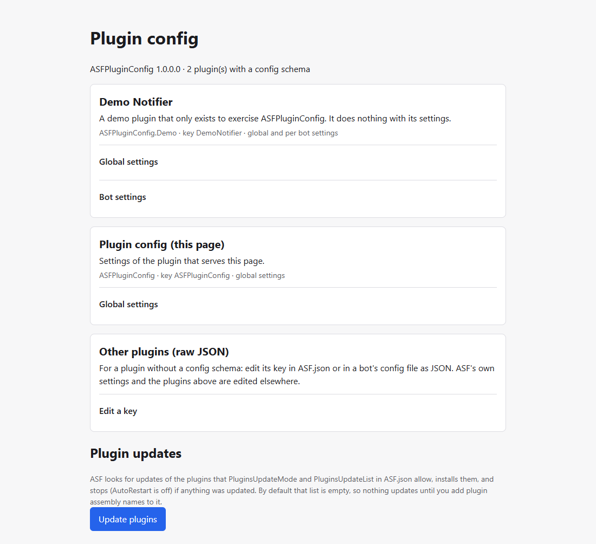

# ASF-PluginConfig

An [ArchiSteamFarm](https://github.com/JustArchiNET/ArchiSteamFarm) (ASF) plugin that gives one page to edit the
configuration of other installed plugins. Each plugin that wants a form embeds a JSON Schema in its DLL; the host
builds the form from it and writes the plugin's own key in `ASF.json` or `config/<bot>.json`.

It edits global and per-bot settings, keeps secrets on the server, edits the key of a plugin that has no schema as raw
JSON, and has a button that asks ASF to update plugins. See the [changelog](CHANGELOG.md) and the
[design](https://github.com/easly1989/ASF-PluginConfig/issues/1).



## Install

1. Download `ASFPluginConfig.zip` from the [latest release](https://github.com/easly1989/ASF-PluginConfig/releases/latest).
2. Unzip it into ASF's `plugins/ASFPluginConfig/` folder.
3. Restart ASF.
4. Open `http://<asf-host>:1242/plugin-config/` (with the trailing slash) and enter ASF's IPC password when asked.
   ASF bans an address for an hour after 5 wrong passwords; the page stores the password for the browser tab only
   after ASF accepts it.

Requires ASF 6.3.11.7 or later, with IPC enabled. A plugin references the exact ASF version it was built against and ASF refuses to load it on an older one, so each ASF bump raises this minimum.

Saving needs `IPCPassword` set in `ASF.json`. If ASF's IPC is reachable only from your LAN or a VPN and you prefer not to set one, see [Saving without `IPCPassword`](#saving-without-ipcpassword).


## Use

Each plugin that ships a schema gets a card. Open **Global settings**, or **Bot settings** and pick a bot, then change the form and save:
- **Validation first.** The host checks the value against the plugin's schema. Nothing is written until every field passes; errors appear next to their fields.
- **Only that plugin's key changes.** The host rewrites the plugin's key in `ASF.json` and keeps every other key. Keys inside the plugin's value that the schema does not know are kept too. Comments in `ASF.json` are not kept.
- **No silent overwrite.** If `ASF.json` changed after you opened the form, for example from ASF-ui, the save is refused. Reopen the form and save again.
- **ASF restarts to apply it.** ASF restarts after any change to `ASF.json`. If `AutoRestart` is off, it stops instead, and the page says so before you save.
- **A bot save restarts only that bot.** Bot settings go into `config/<bot>.json`, and ASF restarts just that bot. The bot picker lists the bot config files ASF would load.
- **Updating plugins.** **Update plugins** at the bottom asks ASF to update the plugins its `PluginsUpdateMode` and `PluginsUpdateList` settings allow, and shows ASF's answer. ASF downloads and installs them itself, then restarts if anything changed (or stops, when `AutoRestart` is off); this plugin installs nothing. By default `PluginsUpdateList` is empty, so nothing updates until you add the plugins' assembly names to it, for example `ASFPluginConfig`.
- **Secrets stay on the server.** A secret field (`writeOnly` in the schema) is never sent to the page, only whether it is set. Leave it empty to keep the stored value, type a new one to replace it, or tick **Remove the stored value**.
- **Saving needs `IPCPassword`, unless you opt out.** Saving is refused while `IPCPassword` is empty in `ASF.json`. If ASF's IPC is reachable only from your LAN or a VPN, you can allow saving without it (see below).

A plugin's global settings, with a secret that is set (its value is never shown) and, below it, a bot's settings:


Errors appear next to their fields, and nothing is written until the form is valid (left); the same form on a phone (right):


The update button, after ASF answered (nothing was eligible, so ASF says so in the system's language):


### Plugins without a schema

The **Other plugins (raw JSON)** card edits one top-level key of `ASF.json` or of a bot's config file as JSON. Pick a key the file already has or type a new one, edit the value and save; `null` removes the key. Saves go through the same checks as the forms. ASF's own settings and the keys of plugins that ship a schema are refused there.

Raw values are shown as stored, so a secret in a plugin's key is visible to anyone who can open the page. Reading them therefore needs what saving needs: `IPCPassword`, or the opt-in below; without either the card is hidden and the endpoints answer 403. If a plugin's schema is invalid, or ASF Plugin Config cannot read the schemas at all, the raw editor refuses the affected keys, or every key, since their secrets cannot be told apart; ASF's log says why. A plugin that wants its secrets hidden ships a schema and marks them `writeOnly`.


### Saving without `IPCPassword`

Add this to `ASF.json`, or turn on **Allow saving without IPCPassword** in this plugin's own card on the page while `IPCPassword` is still set:

```json
"ASFPluginConfig": { "AllowWritesWithoutIPCPassword": true }
```

With it on and `IPCPassword` empty, anyone who can reach ASF's IPC can change your plugins' settings. ASF logs a warning at start-up and the page shows one at the top. Secrets are still never returned. Keep IPC reachable only from networks you trust.

With the opt-in on, the page shows a banner (left). With neither `IPCPassword` nor the opt-in, saving is off, the banner says so, and the raw JSON card is hidden (right):


## Security notes

- **The guard is ASF's `IPCPassword`.** Every endpoint of this plugin is under `/Api/PluginConfig/`, which ASF's IPC password check covers. Without a password, ASF itself lets in only loopback and its `KnownNetworks`, and bans an address for an hour after 5 wrong passwords. On top of that, this plugin refuses every save, and every raw read, while `IPCPassword` is empty, unless you opted in.
- **Secrets never leave the host.** A schema field marked `writeOnly` is dropped from every response and reported only as set or not set. A save that leaves it out keeps the stored value, and only an explicit *Remove the stored value* deletes it. A `writeOnly` field must be a plain string property, not an array item.
- **The raw editor cannot reach those secrets.** It refuses ASF's own settings and every key that has a schema, including one whose schema this plugin rejected as invalid. If it cannot tell which keys are safe, because a plugin's schema could not be read, it refuses all of them. For a plugin without a schema, values are shown as stored.
- **The page itself holds no data.** `/plugin-config/` is a static page, served without a password. Everything it shows comes from `/Api` after you enter the IPC password, which the page keeps for the browser tab only.
- **What ASF itself still exposes.** Whoever can use ASF's IPC can already run commands, restart or stop ASF, start and stop bots, and change or delete bot configurations through ASF's own endpoints. This plugin neither widens nor narrows that. It only adds editing the settings of plugins. Keep IPC off the internet.
- **Config files stay plain text on disk**, as in ASF itself. Their permissions are yours to set.
- **Known gaps** are open issues: [#18](https://github.com/easly1989/ASF-PluginConfig/issues/18) (a write by ASF in the instant between this plugin's version check and its file swap is lost) and [#20](https://github.com/easly1989/ASF-PluginConfig/issues/20) (a plugin loaded after start-up is not scanned for a schema).

## For plugin authors: the schema contract

Your plugin keeps reading its settings as it does today, from `OnASFInit` and `OnBotInitModules`. To get a form, embed one
JSON file in your DLL. You need no code change and no shared assembly.

1. Add `config.schema.json` to your plugin project and embed it under a fixed name:

   ```xml
   <ItemGroup>
   	<EmbeddedResource Include="config.schema.json" LogicalName="$(AssemblyName).config.schema.json" />
   </ItemGroup>
   ```

2. Describe your config key and its settings:

   ```json
   {
   	"configKey": "MyPlugin",
   	"title": "My plugin",
   	"description": "What the plugin does, shown on the page.",
   	"global": {
   		"type": "object",
   		"required": ["ServerUrl"],
   		"properties": {
   			"Enabled": { "type": "boolean", "default": true },
   			"ServerUrl": { "type": "string", "format": "uri", "title": "Server URL" },
   			"Token": { "type": "string", "writeOnly": true },
   			"DelayMinutes": { "type": "integer", "minimum": 1, "maximum": 1440, "default": 5 },
   			"Level": { "type": "string", "enum": ["Info", "Warning", "Error"] },
   			"Tags": { "type": "array", "items": { "type": "string" } }
   		}
   	},
   	"bot": {
   		"type": "object",
   		"properties": { "Enabled": { "type": "boolean" } }
   	}
   }
   ```

What the document must contain:
- `configKey`: required. Your top-level key in `ASF.json` and in `config/<bot>.json`. It cannot be one of ASF's own settings. When two plugins claim one key, the assembly whose name sorts first keeps it.
- `global` and `bot`: at least one, each with `"type": "object"`. `global` is the key in `ASF.json`; `bot` is the key in each bot's config.
- `title` and `description`: optional. `title` falls back to `configKey`.
- `$schema`: allowed, and ignored.

Keywords inside a schema; anything else makes the host ignore your schema and log why:

| Keyword | Applies to |
|---|---|
| `type` (required): `object`, `string`, `integer`, `number`, `boolean`, `array` | every schema |
| `title`, `description` (strings); `default` and `enum` (non-empty), whose values must match `type`, `minimum` and `maximum` | every schema |
| `properties`, `required` (names among `properties`) | `object` |
| `items` (required: a `string`, `integer`, `number` or `boolean` schema) | `array` |
| `minimum`, `maximum` (`minimum` ≤ `maximum`) | `integer`, `number` |
| `format`: only `uri` | `string` |
| `writeOnly`: a secret, never sent back to the page; not allowed on array items | `string` |

A `boolean` with a `default` shows as a checkbox. Without one, it shows as *Not set / Yes / No*, and *Not set* leaves the key out. Use this for a per-bot value that inherits a global one: a checkbox always writes `true` or `false`.

Browsers lose digits beyond 2^53. Store a larger integer, such as a SteamID, as a `string`; the host refuses to save an `integer` above that.

If your schema is invalid, the host ignores it, logs why, and its raw editor refuses your key until you fix it, so a secret under that key is never shown.

## Build

Requires the .NET 10 SDK. Clone with submodules: `git clone --recursive`.

- Build: `dotnet build -c Release`
- Test: `dotnet test ASFPluginConfig.Tests -c Release`
- Package: `dotnet publish ASFPluginConfig -c Release -o out/plugin -p:UseAppHost=false`, then zip the folder's
  contents (not the folder) as `ASFPluginConfig.zip`.

## License

[Apache-2.0](LICENSE)
